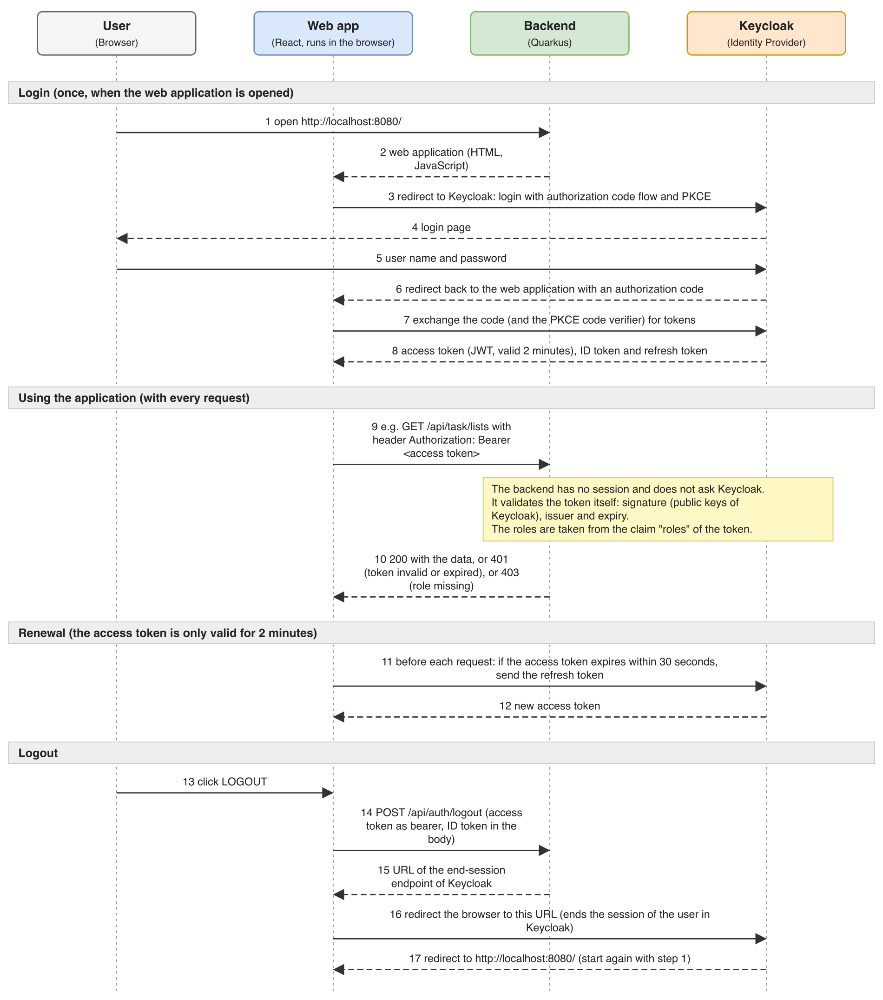

:toc: macro
toc::[]

== Access-Control

Now, we will create the authorization for our application.
We will learn how to create permission and groups as well as how to apply permisions to business logic.

=== Authentication

The authentication happens via IAM where we use https://www.keycloak.org/[Keycloak].
It is already set up for you, so you only need to understand how it works:

* The frontend redirects the user to the Keycloak login page (authorization code flow with PKCE).
After a successful login the frontend receives a signed access token (JWT) and sends it as `Authorization: Bearer <token>` header with every request to the backend.
* The backend does not know any passwords and does not have a session.
It uses the `quarkus-oidc` extension that validates the token of every request (signature, issuer and expiry) and turns the roles contained in the token into the roles of the current user.
This is configured in `backend/src/main/resources/application.properties`.
* Keycloak runs as a container on port `8180` (see link:setup.asciidoc[setup] and link:docker-compose.asciidoc[docker-compose]).
* The realm of Keycloak is defined in `backend/src/main/resources/keycloak/quarkus-realm.json` and imported on startup.
Every permission of our application (see `ApplicationAccessControlConfig`) exists as a role in this realm.

The following diagram shows how the parts work together, from the login to the logout:

* *Steps 1-8 (login)*: the backend delivers the web application, which sends the user to Keycloak.
The user enters the credentials only at Keycloak, never in our application.
The web application receives the tokens in exchange for the authorization code.
* *Steps 9-10 (every request)*: the web application sends the access token with each request to the backend.
The backend checks the token itself and answers with `401` if it is invalid or expired.
If the user lacks the role (permission) required by the use-case, it answers with `403`.
You will build exactly this check with `@RolesAllowed` in the following authorization part.
* *Steps 11-12 (renewal)*: the access token is only valid for two minutes.
Before each request the web application checks whether it is still valid for at least 30 seconds and otherwise gets a new one from Keycloak with the refresh token.
* *Steps 13-17 (logout)*: the backend only builds the URL of the Keycloak end-session endpoint; Keycloak ends the session of the user when the browser calls it.

The following test users are available (the password is the same as the username):

[options="header"]
|===
| User | Permissions
| `reader` | `FindTaskList`, `FindTaskItem`
| `writer` | permissions of `reader` and `SaveTaskList`, `SaveTaskItem`
| `manager` | permissions of `writer` and `DeleteTaskList`, `DeleteTaskItem`
|===

You can log in with these users in the web application.
The `Logout` button ends your session in Keycloak.

NOTE: The access token stays valid until it expires, as the backend only validates it and does not ask Keycloak for every request.
For this reason the realm issues access tokens that are only valid for two minutes.
After a logout a token can therefore only be used for a short time and cannot be renewed anymore.
To invalidate tokens immediately you would have to let the backend ask Keycloak for every request (token introspection), which costs an additional call per request.

NOTE: The users, passwords and secrets of this realm are meant for training only.

=== Authorization

We have already prepared the class `ApplicationAccessControlConfig` for you containing the available permissions of our application.
Next we extend our use-cases with authorization so they can only be executed by users with the required permission.

==== Use-Cases

All we need to do is to annotate all our public use-case methods with `@RolesAllowed` specifying the according permission as in the following example:

[source,java]
----
@Named
@Transactional
public class UcDeleteTaskItem {
  // ...
  @RolesAllowed(ApplicationAccessControlConfig.PERMISSION_DELETE_TASK_ITEM)
  public void delete(Long id) {
    // ...
  }
  // ...
----

==== Unit Testing

Now, we want to test our authorization via JUnit.
All we need to do is add the following annotation to our use-case test methods as in the following example:

[source,java]
----
@Test
@TestSecurity(user = "test-user", roles = ApplicationAccessControlConfig.PERMISSION_DELETE_TASK_ITEM)
public void testDeleteTaskItem() {
  // ...
}
----

If have not yet created tests for use-cases, create them now.
Also test that a user without the required permission is rejected (`io.quarkus.security.ForbiddenException`), and an anonymous user, too (`io.quarkus.security.UnauthorizedException`).

==== Manual Testing

Start the application in dev mode as described in the link:setup.asciidoc[setup] (database and Keycloak containers running; the frontend is delivered by the backend), open http://localhost:8080/ and log in with the different test users from above.
To log in as another user, log out first with the `LOGOUT` button.
Verify that each user can access only the functionality assigned to their role and that unauthorized actions are denied.
The web application shows a message if the backend refuses an action because of missing permissions.

==== Links

* https://github.com/devonfw/devon4j/blob/develop/documentation/guide-access-control.asciidoc#access-control[devon4j: Access-Control]
* https://github.com/devonfw/devon4j/blob/develop/documentation/guide-security.asciidoc#security[devon4j: Security]
* https://quarkus.io/guides/security-oidc-bearer-token-authentication[Quarkus: OIDC Bearer token authentication]
